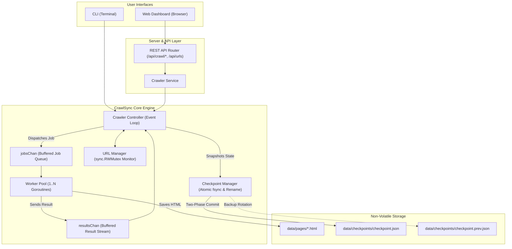

# CrawlSync

> **Concurrent Web Crawler with Worker-Pool Management, Atomic Checkpointing, and Fault Recovery**

[](https://go.dev/)
[](docs/TECHNICAL_AUDIT.md)
[](docs/TECHNICAL_AUDIT.md)
[]()

---

## 1. Project Introduction

### What is CrawlSync?
**CrawlSync** is a high-performance, concurrent web crawler built in Go. It discovers, downloads, normalizes, and indexes webpages across websites while giving users real-time visibility and control through both a command-line interface (CLI) and an interactive web dashboard.

### What Problem Does it Solve?
The World Wide Web is an enormous directed graph where webpages are nodes and hyperlinks are edges. Downloading pages one-by-one in a single-threaded loop is painfully slow because the computer spends over 95% of its time idling while waiting for remote web servers to respond over the network (I/O latency). 

CrawlSync solves this by executing multiple downloads concurrently, scheduling tasks dynamically across a pool of reusable worker threads, detecting and filtering duplicate links, and ensuring that no progress is lost if the crawler is paused, stopped, or interrupted by a system crash.

### Why Was it Developed?
CrawlSync was designed as an undergraduate **Operating Systems end-term project**. Rather than treating OS concepts as abstract textbook theory, CrawlSync serves as a working laboratory demonstrating fundamental operating system principles in real Go code:
- **Multithreading & Concurrency:** Overlapping network I/O across independent execution units.
- **Producer-Consumer Queues:** Channel-based task dispatching and results aggregation.
- **Mutual Exclusion & Critical Sections:** Thread-safe state synchronization without race conditions.
- **Deadlock Avoidance:** Strict unidirectional communication pipelines that eliminate circular wait.
- **Persistence & Crash Recovery:** Atomic file replacement and non-volatile state reconstruction.

### What Does it Mean for a Web Crawler to be Concurrent?
In a sequential crawler, downloading Page A blocks everything else until the response bytes arrive; only then does the crawler parse Page A, find a link to Page B, and download Page B.

In a **concurrent** crawler:
1. Worker 1 requests Page A. While waiting for the server to reply...
2. Worker 2 requests Page B. While waiting for the server to reply...
3. Worker 3 requests Page C.
4. As soon as any worker receives a response, it parses the HTML, discovers new hyperlinks, feeds them into a shared queue, and immediately grabs the next pending URL.

Throughput scales almost linearly with the number of worker threads until network bandwidth or target server capacity is reached.

### Why are Checkpoints and Recovery Useful?
Crawling thousands or millions of pages can take hours or days. If power cuts out, the network drops, or the user presses `Ctrl+C`, an ordinary crawler loses its entire in-memory state and must restart from scratch. 

CrawlSync periodically creates **atomic checkpoints** on disk. When restarted with `--resume`, CrawlSync inspects the checkpoint, reconstructs the list of completed and pending URLs, resets interrupted in-flight downloads, and resumes seamlessly without ever re-downloading previously completed pages.

---

## 2. Features

- **Concurrent Downloading:** Multiple worker goroutines download webpages simultaneously without blocking one another.
- **Worker Pool Management:** Bounded concurrency using a configurable pool of 1 to 20 workers, preventing memory and socket exhaustion.
- **URL Discovery & State Tracking:** Tracks every URL through a strict state machine: `pending`, `in_progress`, `completed`, or `failed`.
- **Atomic Duplicate Detection:** Canonical URL normalization (lowercasing, default port removal, fragment stripping, trailing-slash normalization) combined with thread-safe test-and-set to prevent redundant downloads and infinite spider traps.
- **Streaming HTML Tokenization:** High-speed streaming HTML tokenization using `golang.org/x/net/html` to extract links without loading entire document object models into memory.
- **Two-Phase Atomic Checkpointing:** Checkpoint snapshots are staged in temporary files, synced to physical storage via hardware `fsync`, backed up to `.prev.json`, and swapped via atomic `os.Rename`.
- **Crash Recovery & Resume:** Restores past crawl sessions using `--resume`. Resets interrupted `in_progress` downloads to `pending` and preserves the completed set.
- **Runtime Pause & Resume:** Pause the crawl to temporarily halt job dispatching while allowing in-flight downloads to finish cleanly. Resume dispatching at any time.
- **Graceful Shutdown:** Traps `SIGINT` (Ctrl+C) and `SIGTERM`, allows in-flight workers to conclude, and commits a final shutdown checkpoint before exiting cleanly with code 0.
- **Dark-Themed Web Dashboard:** Real-time web dashboard featuring live telemetry polling (1 Hz), progress visualization with Chart.js, per-worker activity monitoring, and server-side paginated URL Explorer.
- **URL Explorer with Filtering & Pagination:** Browse discovered URLs by status (`all`, `completed`, `pending`, `failed`), depth, and sequence order with smooth multi-page pagination.
- **SSRF Security Protection:** Dial-time IP inspection blocks requests to localhost, private RFC1918 subnets, and cloud metadata endpoints by default (with an explicit `--allow-local` flag for local testbeds).

---

## 3. How It Works

### The Crawling Lifecycle
1. **Initiation:** The user supplies a starting seed URL (e.g., `http://127.0.0.1:9000/`) and configuration parameters (worker count, max pages, max depth).
2. **Scheduling:** The starting URL is normalized and scheduled into the thread-safe `URLManager` with status `pending`.
3. **Dispatch:** The centralized Controller pulls URLs from the pending queue and dispatches `Job` tasks into the buffered `jobsChan`.
4. **Concurrent Fetch:** An idle worker goroutine receives the job, performs an HTTP GET request with a timeout deadline, enforces response size caps (5 MB), and rejects non-HTML content types.
5. **Persistence Before Completion:** The worker writes the raw HTML to a temporary file on disk, invokes `f.Sync()`, and renames it to `data/pages/<slug>.html`. **Rule 1 Invariant:** A page is marked `completed` only *after* its HTML is safely on disk.
6. **Link Parsing:** The worker parses hyperlinks from the HTML stream, converts relative paths to absolute URLs, filters out external domains (if same-domain is enabled), and bundles discovered URLs into a `CrawlResult`.
7. **Results Aggregation:** The worker sends the `CrawlResult` over `resultsChan` back to the Controller. The Controller updates statistics and calls `TrySchedule()` on each newly discovered URL.
8. **Periodic Checkpoint:** At safe event loop boundaries, the Controller snapshots state and atomically commits `checkpoint.json`.
9. **Termination or Interruption:** Crawling terminates when `pending == 0 && in_progress == 0`, when `max_pages` is reached, or when the user issues a Pause/Stop command.

### System Architecture Diagram



---

## 4. Technology Stack

CrawlSync uses Go's standard library almost exclusively, avoiding unnecessary dependencies:

| Technology | Role in CrawlSync |
| :--- | :--- |
| **Go (1.22+)** | Core systems programming language providing type safety, memory safety, and high-performance compilation. |
| **Goroutines** | Lightweight user-space threads (starting at 2 KB stack) managed by Go's G-M-P runtime scheduler for high-concurrency downloads. |
| **Buffered Channels** | Thread-safe FIFO communication pipelines (`jobsChan`, `resultsChan`) implementing Hoare's Communicating Sequential Processes (CSP). |
| **`sync.Mutex` & `sync.RWMutex`** | Mutual exclusion primitives safeguarding critical sections in the URL Manager, Worker Pool, and Checkpoint Manager. |
| **`sync.WaitGroup`** | Thread barrier synchronization ensuring all active worker goroutines drain cleanly before shutdown. |
| **`net/http` & `net/url`** | Production-grade HTTP client with TCP connection pooling (Keep-Alive), request timeouts, and RFC 3986 URI normalization. |
| **`golang.org/x/net/html`** | Streaming HTML tokenization parser used to extract `<a href>` links efficiently without memory-heavy DOM trees. |
| **`encoding/json`** | Serialization engine for structured checkpoint persistence and REST API payloads. |
| **`os` & `syscall`** | Low-level filesystem operations: `os.Rename` for atomic file replacement, `file.Sync()` for `fsync` disk durability, and OS signal trapping. |
| **Python Standard Library** | Provides `http.server.ThreadingHTTPServer` powering the local 37-page delayed test website (`test_server.py`). |
| **HTML5, CSS3, JavaScript** | Zero-framework, responsive web dashboard featuring glassmorphic controls, mobile off-canvas drawer, and accessibility shortcuts. |
| **Chart.js (v4.4.1)** | Client-side visualization library rendering real-time crawl progress donut charts without build steps. |

---

## 5. Project Structure

```
crawlsync/
├── cmd/
│   └── crawlsync/
│       └── main.go                  # CLI & Server entrypoint, flag parsing, signal handling
├── internal/
│   ├── controller/
│   │   ├── controller.go            # Scheduler event loop, lifecycle state machine, pause/resume
│   │   ├── worker.go                # Worker pool management, HTML downloading, disk writing
│   │   └── controller_test.go       # Concurrency, worker pool, and shutdown integration tests
│   ├── fetcher/
│   │   ├── fetcher.go               # HTTP client, timeout deadlines, size limits, SSRF protection
│   │   ├── robots.go                # robots.txt parser and politeness checking
│   │   └── fetcher_test.go          # Unit tests for fetcher and SSRF filters
│   ├── parser/
│   │   ├── links.go                 # Streaming HTML tokenizer and relative URL resolution
│   │   └── links_test.go            # HTML link extraction tests
│   ├── server/
│   │   ├── handlers.go              # REST API route handlers (/api/crawl/*, /api/workers)
│   │   ├── handlers_url.go          # Paginated, filtered, and sorted URL queries (/api/urls)
│   │   ├── models.go                # JSON request/response Data Transfer Objects (DTOs)
│   │   └── service.go               # Bridge between HTTP API and Crawler Controller
│   ├── state/
│   │   ├── checkpoint.go            # Two-phase atomic checkpoint persistence and fsync
│   │   ├── recovery.go              # Checkpoint loading, backup fallback, and queue reconstruction
│   │   └── checkpoint_test.go       # Checkpoint and recovery unit tests
│   └── urlmanager/
│       ├── manager.go               # URL registry monitor, status tracking, TrySchedule
│       ├── normalize.go             # Canonical URL normalization and trailing-slash rules
│       └── query.go                 # In-memory sorting, filtering, and pagination logic
├── web/                             # Embedded Web Dashboard
│   ├── index.html                   # Dashboard UI markup and component layout
│   ├── css/styles.css               # Dark-theme styles, collapsible sidebar, floating control pill
│   ├── js/
│   │   ├── api.js                   # REST API client with same-origin resolution
│   │   ├── app.js                   # UI event wiring, keyboard shortcuts (Ctrl+B), mobile drawer
│   │   ├── components.js            # Reusable DOM rendering helpers
│   │   └── dashboard.js             # Telemetry polling, Chart.js updates, URL table pagination
│   └── fs.go                        # Go 1.16+ embed.FS embedding dashboard files into the binary
├── testsite/                        # Local Test Website (37 Pages)
│   ├── server.py                    # Multithreaded Python HTTP server with artificial delay
│   ├── index.html                   # Testbed portal homepage
│   ├── sitemap.html                 # Comprehensive site directory
│   └── *.html                       # 35 academic OS topic pages, cross-links, and 404 test pages
├── data/                            # Runtime Storage (Excluded from Git)
│   ├── pages/                       # Downloaded HTML files (*.html)
│   └── checkpoints/                 # Checkpoint snapshots (checkpoint.json, checkpoint.prev.json)
├── docs/                            # Documentation & Architecture
│   ├── ARCHITECTURE.md              # Deep architectural specification
│   ├── OS_CONCEPTS.md               # OS concept mapping for academic viva preparation
│   ├── TECHNICAL_AUDIT.md           # Formal technical audit against course requirements
│   └── REPORT_FACTS.md              # Comprehensive technical report reference
├── test_server.py                   # Root launcher for the Python test server
├── go.mod                           # Go module definition
└── README.md                        # This document
```

---

## 6. Prerequisites

Before running CrawlSync, ensure you have the following installed:

1. **Go:** Version 1.22 or newer.
   - Verify installation:
     ```bash
     go version
     ```
2. **Python:** Version 3.8 or newer (required to run the local 37-page test website).
   - Verify installation:
     ```bash
     python --version    # or python3 --version
     ```
3. **Git:** (Optional, for cloning the repository).
   - Verify installation:
     ```bash
     git --version
     ```

---

## 7. Installation and Setup

### 1. Clone or Download the Repository
```bash
git clone https://github.com/your-username/crawlsync.git
cd crawlsync
```

### 2. Download Go Dependencies
CrawlSync uses standard Go modules. Download the single external dependency (`golang.org/x/net`):
```bash
go mod download
```

### 3. Verify Code Health
Run the entire test suite with the Go race detector enabled to verify clean operation on your system:
```bash
# Windows PowerShell
go test -count=1 -race ./...
go vet ./...

# Linux / macOS
go test -count=1 -race ./...
go vet ./...
```
*(All tests should report `ok` with zero race warnings).*

### 4. Build Standalone Executable (Optional)
You can compile a standalone, self-contained binary embedding the web dashboard:
```bash
# Windows PowerShell
go build -o crawlsync.exe ./cmd/crawlsync

# Linux / macOS
go build -o crawlsync ./cmd/crawlsync
```

---

## 8. Running the Local Test Website

CrawlSync includes an internal test website located in `testsite/` containing **37 interconnected HTML pages** on Operating Systems topics. It is powered by Python's `ThreadingHTTPServer` and supports artificial response latency for comfortable testing of concurrency, pauses, resumes, and checkpoints.

### Start the Test Server
In a separate terminal window, launch the test server:

```bash
# Windows PowerShell
python test_server.py

# Linux / macOS
python3 test_server.py
```

By default:
- **Server Address:** `http://127.0.0.1:9000/`
- **Artificial Delay:** `2.0` seconds per request.
- **Pages Available:** 37 distinct HTML pages + deliberate simulated 404 failure links (`nonexistent-page.html`, `missing-document.html`).
- **Request Logging:** Every incoming request prints timestamps, client IPs, worker thread names, and response durations in real-time.

#### Customizing Test Server Options
```bash
# Set faster response delay (e.g. 0.2 seconds per page)
python test_server.py --port 9000 --delay 0.2

# Set custom bind address
python test_server.py --host 127.0.0.1 --port 9000 --delay 1.0
```

---

## 9. Example Usage

### Mode 1: CLI Crawler Mode

In CLI mode, CrawlSync outputs live crawl logs directly to your terminal.

> **Note on Localhost Crawling:** By default, CrawlSync blocks local IP addresses to prevent Server-Side Request Forgery (SSRF). When crawling `127.0.0.1` or `localhost`, always include the `--allow-local` flag.

#### 1. Start a New Crawl
Crawl the local test site using 4 concurrent workers, a maximum limit of 50 pages, and a maximum discovery depth of 4:
```bash
# Windows PowerShell
go run ./cmd/crawlsync --url http://127.0.0.1:9000/ --allow-local --workers 4 --max-pages 50 --max-depth 4

# Linux / macOS
go run ./cmd/crawlsync --url http://127.0.0.1:9000/ --allow-local --workers 4 --max-pages 50 --max-depth 4
```

#### 2. Gracefully Interrupt the Crawl
Press `Ctrl+C` while crawling is in progress. CrawlSync traps the interrupt signal, waits for active worker downloads to complete, flushes write buffers, commits an atomic shutdown checkpoint to `data/checkpoints/checkpoint.json`, and exits cleanly.

#### 3. Resume the Interrupted Crawl
Resume from the latest checkpoint without re-downloading previously completed pages:
```bash
go run ./cmd/crawlsync --resume --allow-local
```

#### 4. Resume and Retry Previously Failed URLs
If certain pages failed due to transient network drops, retry them during recovery:
```bash
go run ./cmd/crawlsync --resume --retry-failed --allow-local
```

---

### Mode 2: Web Dashboard Mode (Recommended)

When `--serve` is supplied, CrawlSync runs as an HTTP server and serves the interactive dashboard.

```bash
# Start server with local testbed crawling allowed
go run ./cmd/crawlsync --serve --allow-local --port 8080
```

Open your browser and navigate to:
```
http://127.0.0.1:8080/
```

#### Starting on a Custom Port
```bash
go run ./cmd/crawlsync --serve --allow-local --port 8081
```

---

## 10. Dashboard Guide

The CrawlSync dashboard provides real-time visibility into the internal state of the crawler without needing to inspect terminal logs:

```
+------------------------------------------------------------------------------------+
|  [Logo] CrawlSync    [State: RUNNING]  Session: session_...  Uptime: 00:01:23     |
+------------------------------------------------------------------------------------+
| [Stat Cards]                                                                       |
|  Total Discovered: 42   Completed: 38 (90.5%)   Pending: 0   Failed: 4   Speed: 1.9 p/s
+------------------------------------------------------------------------------------+
| [Worker Monitor]                                                                   |
|  Worker 1: IDLE        Worker 2: DOWNLOADING http://127.0.0.1:9000/concurrency.html|
|  Worker 3: IDLE        Worker 4: IDLE                                              |
+------------------------------------------------------------------------------------+
| [URL Explorer]                                                                     |
|  Filter: [All / Completed / Pending / Failed]   Sort: [Sequence / Depth / Duration]|
|  --------------------------------------------------------------------------------- |
|  #1  http://127.0.0.1:9000/              [COMPLETED] 200 OK   7.8 KB  2012 ms      |
|  #2  http://127.0.0.1:9000/about.html    [COMPLETED] 200 OK   6.5 KB  2008 ms      |
|  #3  http://127.0.0.1:9000/nonexistent.html [FAILED] 404      0.1 KB  2004 ms      |
|  Showing 1 - 20 of 42 filtered (Total: 42)                  [<- Prev] [Next ->]    |
+------------------------------------------------------------------------------------+
|            [ Start ]   [ Pause ]   [ Resume ]   [ Stop ]   [ Checkpoint ]          |
+------------------------------------------------------------------------------------+
```

### Dashboard Components:
1. **Header & Status Badges:** Displays backend connection health, current crawler lifecycle state (`IDLE`, `RUNNING`, `PAUSED`, `STOPPED`, `COMPLETED`), active session ID, and uptime counter.
2. **Summary Stat Cards:** Live metrics showing total discovered URLs, completed downloads (with percentage), pending queue count, failed URL count, and real-time crawl speed (pages/sec).
3. **Crawl Progress & Chart.js Visualizer:** Donut chart reflecting the proportion of completed, in-progress, pending, and failed URLs.
4. **Worker Activity Monitor:** Real-time card for every worker thread displaying its current status (`IDLE` vs `DOWNLOADING`) and the exact URL currently being fetched.
5. **URL Explorer Table:** Comprehensive data grid displaying sequence numbers, URLs, status badges, HTTP status codes, payload sizes, download durations, and discovery depths.
6. **Server-Side Pagination:** When discovered URLs exceed 20 items, pagination controls (`← Prev` and `Next →`) allow smooth browsing across multiple pages without browser lag.
7. **Collapsible Sidebar:** Expand or collapse the navigation sidebar with a smooth animation. Press `Ctrl+B` (or `Cmd+B` on macOS) to toggle via keyboard. Preferences are saved in `localStorage`.
8. **Mobile Off-Canvas Drawer:** On tablet and mobile screens ($\le 768\text{px}$), the sidebar transitions into a drawer with backdrop overlay.
9. **Floating Control Pill:** Fixed, glassmorphic bottom control pill containing primary runtime actions:
   - **Start:** Opens crawl configuration modal to initiate a new crawl.
   - **Pause:** Temporarily halts job dispatching; in-flight downloads conclude normally.
   - **Resume:** Resumes job dispatching from the pending queue.
   - **Stop:** Issues a graceful termination signal and captures a shutdown checkpoint.
   - **Save Checkpoint:** Triggers an immediate, on-demand atomic checkpoint to disk.

---

## 11. Checkpoint and Recovery

### What Gets Saved?
Checkpoints are serialized to clean, indented JSON format (`checkpoint.json`). Each snapshot records:
- `version`: Checkpoint schema version (currently `1`).
- `session_id`: Unique cryptographic session identifier (e.g. `session_1793855570_4679c9be0c49ad79`).
- `created_at`: UTC ISO-8601 timestamp.
- `sequence`: Monotonically increasing checkpoint sequence counter.
- `config`: Crawl parameters (start URL, worker count, max pages, max depth, timeout, storage directories).
- `stats`: Aggregate counts (total discovered, completed, in-progress, pending, failed).
- `urls`: Complete array of all URL records with metadata (status, HTTP code, payload size, duration, discovered depth, timestamp, and saved file path on disk).

### Where are Checkpoints Stored?
Checkpoints are saved inside the `data/checkpoints/` directory:
- `checkpoint.json`: The latest valid committed state.
- `checkpoint.prev.json`: The previous valid backup (for automatic rollback if a write fails).

### How Atomic Persistence Works
Writing directly to an existing file in-place is unsafe: an unexpected crash or power cut leaves the file truncated and unreadable. CrawlSync uses a **Two-Phase Commit Protocol**:
1. Serialize JSON and write completely to a uniquely named temporary file: `checkpoint-<timestamp>-*.tmp`.
2. Call `tmpFile.Sync()` to flush the OS page cache to physical storage (`fsync` / `FlushFileBuffers`).
3. Rotate existing `checkpoint.json` into `checkpoint.prev.json`.
4. Atomically swap the temporary file into `checkpoint.json` using `os.Rename`.

### How Recovery Works
When launching with `--resume`:
1. `state.LoadWithFallback()` parses `checkpoint.json`. If corrupted, it falls back to `checkpoint.prev.json`.
2. `urlManager.Restore()` reconstructs the internal state:
   - All `completed` URLs are restored into the visited map. They are **never** re-downloaded.
   - All `in_progress` URLs (downloads interrupted by the crash) are moved back to `pending`.
   - All `failed` URLs remain failed (or are retried if `--retry-failed` is passed).
3. The Controller repopulates the job queue and launches workers to continue where the crawl left off.

---

## 12. Testing

CrawlSync includes unit tests, integration tests, race detection tests, and end-to-end browser tests:

```bash
# 1. Run all Go unit and concurrency tests with race detector
go test -count=1 -race ./...

# 2. Run Go vet static analysis
go vet ./...

# 3. Validate frontend JavaScript syntax
node -c web/js/api.js web/js/app.js web/js/components.js web/js/dashboard.js

# 4. Verify test website accessibility (37 HTML pages + 404 links)
python scratch/verify_testsite.py

# 5. Run full end-to-end crawl and interactive Chrome CDP pagination test
node scratch/test_stage1_e2e.mjs
```

### What These Tests Validate:
- **`internal/controller`:** Worker pool dispatching, dynamic channel select multiplexing, empty queue termination, deterministic pause/resume semantics, and graceful shutdown.
- **`internal/fetcher`:** HTTP request timeout deadlines, response size caps (5 MB), non-HTML content-type rejection, and SSRF loopback/private IP blocking.
- **`internal/parser`:** `<a href>` extraction, relative-to-absolute URL resolution, malformed HTML resilience, and same-domain restrictions.
- **`internal/state`:** Checkpoint serialization, atomic replacement, hardware `fsync` flushing, backup rotation, and crash rollback.
- **`internal/urlmanager`:** Canonical URL normalization, atomic `TrySchedule` check-and-insert, TOCTOU race elimination, and in-memory sorting/pagination.
- **`internal/server`:** REST API contracts, Go 1.22 ServeMux routing, status code responses, CORS headers, and dashboard file serving.

---

## 13. Troubleshooting

### 1. Port Already in Use (`bind: address already in use` / `WinError 10048`)
- **Cause:** Another instance of CrawlSync or an existing application is already using port `8080` (for the server) or port `9000` (for the test server).
- **Solution:** 
  - For CrawlSync: specify a different port using `--port <number>`:
    ```bash
    go run ./cmd/crawlsync --serve --port 8085
    ```
  - For the test server: specify a different port using `--port <number>`:
    ```bash
    python test_server.py --port 9005
    ```

### 2. Cannot Crawl Localhost (`connection to private/local IP blocked`)
- **Cause:** CrawlSync's built-in SSRF security filter prevents accidental connections to internal network addresses.
- **Solution:** Include the `--allow-local` flag:
  ```bash
  go run ./cmd/crawlsync --url http://127.0.0.1:9000/ --allow-local
  ```

### 3. Checkpoint Recovery Fails (`no valid checkpoint found`)
- **Cause:** You ran `--resume` but no prior crawl has created a `checkpoint.json` inside the checkpoint directory.
- **Solution:** Run a fresh crawl first without `--resume` to establish a baseline checkpoint.

### 4. Dashboard Displays "Cannot connect to CrawlSync server"
- **Cause:** The frontend cannot communicate with the Go backend (server is not running or port mismatch).
- **Solution:** Confirm that `go run ./cmd/crawlsync --serve` is actively running in a terminal. If running behind a custom port (e.g. `8085`), open the dashboard at `http://127.0.0.1:8085/`. The API client automatically resolves relative to the current port.

### 5. Python Test Server Times Out
- **Cause:** Default request delay is 2.0 seconds per page. If crawling with high worker counts or low timeouts, requests may queue up.
- **Solution:** Reduce the delay when testing high page volumes:
  ```bash
  python test_server.py --delay 0.1
  ```

---

## 14. Limitations

CrawlSync is intentionally designed as an academic demonstration of Operating Systems concurrency rather than a commercial web crawler:

1. **No JavaScript Execution:** CrawlSync downloads raw HTML over HTTP/HTTPS. It does not run a headless browser engine (such as Chromium or V8) and cannot execute client-side single-page applications (React, Vue, Angular) that render content dynamically via client-side JavaScript.
2. **Single-Node Architecture:** CrawlSync coordinates workers via in-memory Go channels on a single machine. It is not a distributed crawler (such as Apache Nutch) spanning multiple cluster nodes.
3. **HTTP/HTML Scope Only:** The fetcher rejects non-HTML assets (PDFs, images, videos, audio, binary archives) based on `Content-Type` headers to conserve bandwidth and disk storage.
4. **Robots.txt Scope:** Basic robots.txt politeness filtering is implemented, but complex extensions (such as `Crawl-Delay` per-IP rate throttling or dynamic sitemap XML ingestion) are not enabled by default.

---

## 15. Academic Context: Operating Systems Concepts Demonstrated

| Operating Systems Concept | Real Implementation in CrawlSync |
| :--- | :--- |
| **Multithreading & Concurrency** | Bounded worker pool of goroutines executing overlapping network I/O in `internal/controller/worker.go`. |
| **Producer-Consumer Pattern** | Buffered Go channels (`jobsChan`, `resultsChan`) decoupling work generation from execution in `internal/controller/controller.go`. |
| **Critical Sections & Mutual Exclusion** | `sync.Mutex` and `sync.RWMutex` protecting shared in-memory registries in `internal/urlmanager/manager.go`. |
| **Deadlock Avoidance** | Coffman circular wait eliminated by streaming discovered child URLs through a separate results pipeline. |
| **Thread Barriers & Synchronization** | `sync.WaitGroup` used to barrier-synchronize clean worker draining during shutdown in `controller.go:Run()`. |
| **Process State Persistence** | Serializing in-memory process memory to non-volatile secondary storage (`data/checkpoints/checkpoint.json`). |
| **Atomic File Operations** | Two-phase commit using temporary files, OS directory entry swap (`os.Rename`), and backup rotation. |
| **Filesystem Durability (fsync)** | Invoking `file.Sync()` before closing files to force write buffers from OS page cache onto physical media. |
| **Signal Interception & Graceful Termination** | Trapping `SIGINT`/`SIGTERM` via `signal.NotifyContext` to flush state and exit with code 0 without data corruption. |
| **Crash Recovery & Fault Tolerance** | Reconstructing execution state from disk, converting in-flight work back to pending, and avoiding duplicate work. |

---

## 16. Course Attribution

Developed for the **Operating Systems End-Term Project (Semester 5)**.  
Built for academic exploration of concurrent systems programming, synchronization, and storage durability.
